Below is a **Program 1-only design brief / prompt constraint + technical design** for Hex Titanium’s local bolt-specification web system. It focuses on what must be built, what must not be built, features, logic, ERD, process flows, and notes.

---

# Program 1 Design Brief — Local Web-Based Bolt Specification System

## 1. Prompt / Design Constraints

### 1.1 What MUST be there

- A **local web application** running on the shop computer via `localhost` / local Wi-Fi LAN.
- Accessible from:
  - shop cashier computer,
  - staff smartphones connected to the shop Wi-Fi.
- **No paid server, no domain, no cloud requirement**.
- Stack constraint:
  - PostgreSQL database,
  - Node.js + Express.js backend,
  - Vue.js responsive frontend.
- Custom software engineering; **no instant website builder**.
- Database contains:
  - motorcycle brand, model, variant, year,
  - bolt positions, e.g. engine cover, caliper, handlebar,
  - bolt specs: diameter × length, e.g. `M6×20`, head type, quantity,
  - minimum **20 popular motorcycle types**.
- Core feature: **automatic bolt pick-list**.
  - Staff selects motorcycle type.
  - System instantly shows required bolts grouped by position and consolidated totals.
- Integration with Program 3:
  - system can read package/bundling composition,
  - system can generate pick-list for a package,
  - but Program 1 **does not own discount/pricing logic**.
- Role-based access:
  - Admin/Owner: full CRUD, import, backup, user management.
  - Staff: search, view, generate pick-list, checklist, print/export.
- Manual book / digital operational guide for staff.
- Backup and restore function.
- Audit-friendly: at least track who created/updated critical data and pick sessions.
- Indonesian UI language.
- Responsive UI for desktop and smartphone.
- Must support staff to operate independently from owner.
- Must support evaluation:
  - baseline service time,
  - after-implementation service time,
  - SUS questionnaire,
  - partner feedback.

### 1.2 What MUST NOT be there

- No public website / public catalog.
- No e-commerce checkout.
- No payment gateway.
- No cashier/accounting replacement; **Kelola app remains for transactions**.
- No full ERP, inventory stock ledger, supplier management, or purchase order system.
- No customer CRM or customer account system.
- No marketplace integration.
- No cloud hosting, paid domain, or paid SaaS dependency.
- No native mobile app requirement; responsive browser UI is enough.
- No AI image recognition or automatic bolt measurement hardware.
- No automatic social media posting.
- No logo/photo/content production features; those belong to Program 2.
- No bundling discount calculation engine; pricing belongs to Program 3.
- No multi-branch / multi-tenant support.

### 1.3 Non-functional constraints

- Must work offline on local network.
- Pick-list generation should return in ≤ 2–3 seconds for 20 motorcycle types.
- Data input must be validated before saving.
- Master data deletion should use soft delete / deactivate, not hard delete when referenced.
- Daily backup recommended via `pg_dump` to local disk and USB.
- Simple local authentication with hashed passwords.
- Restrict access to LAN; no public port forwarding.
- Local static IP recommended for shop computer.
- Provide in-app manual and printable PDF guide.

---

## 2. Actors and Roles

| Actor | Rights |
|---|---|
| Admin / Owner | Manage users, motorcycles, positions, bolt specs, requirements, packages read-only, import, backup/restore, view audit log |
| Staff | Login, search motorcycle, view requirements, generate pick-list, check items, print/export pick-list |
| Technician / Data Entry optional | Add/edit requirement data if granted by Admin |
| Dosen / Evaluator | No system access; evaluates documents, baseline, SUS, and reports |

---

## 3. MVP Features and Screen Map

### 3.1 Features

1. **Authentication and role authorization**
2. **Dashboard**
   - quick motorcycle search,
   - recent pick-lists,
   - data completeness warning.
3. **Motorcycle master**
   - brand, model, variant, year, display name, notes, active status.
4. **Bolt position master**
   - position name, category, sort order.
5. **Bolt specification master**
   - code, diameter, length, head type, thread pitch, material, finish, notes.
6. **Motorcycle bolt requirement matrix**
   - per motorcycle: position + bolt spec + quantity + side + optional flag.
7. **Automatic pick-list by motorcycle**
   - select motorcycle → generate grouped and consolidated bolt list.
8. **Automatic pick-list by package**
   - select motorcycle + package → generate package bolt list.
9. **Pick session / checklist**
   - staff marks items as prepared, saves session, prints/exports.
10. **Search and filter**
    - by brand, model, variant, year, bolt size, position.
11. **CSV import for requirements**
    - validate all rows before commit.
12. **Backup / restore**
    - export/import database dump or CSV snapshot.
13. **In-app manual book**
    - operational SOP, troubleshooting, backup instructions.
14. **Audit log recommended**
    - login, CRUD, import, restore, pick-list generation.

### 3.2 Suggested screens

- `/login`
- `/dashboard`
- `/motorcycles`
- `/motorcycles/:id/requirements`
- `/bolt-specs`
- `/positions`
- `/pick-list`
- `/pick-list/:sessionId`
- `/packages`
- `/admin/import`
- `/admin/backup`
- `/admin/users`
- `/help/manual`

---

## 4. Core Business Logic and Validation Rules

### 4.1 Motorcycle logic

- Display name generated as: `Brand Model Variant Year`.
- Unique constraint: `brand + model + variant + year_start + year_end`.
- Deactivate instead of delete if referenced.

### 4.2 Bolt requirement logic

- Each requirement row:
  - one motorcycle type,
  - one bolt position,
  - one bolt spec,
  - quantity > 0,
  - optional side: left/right/front/rear/none,
  - optional flag.
- Unique constraint:
  - `motorcycle_type_id + bolt_position_id + bolt_spec_id + side`.
- If same bolt spec appears in multiple positions, system must aggregate quantity in pick-list totals.
- Pick-list must show:
  - per-position breakdown,
  - consolidated total by bolt spec,
  - total distinct bolt specs,
  - total bolt quantity.

### 4.3 Pick-list logic

Input:
- `motorcycle_type_id`
- optional `package_id`

Process:
1. Validate motorcycle exists and active.
2. If package selected, validate package belongs to the same motorcycle and is active.
3. Load requirements or package items.
4. Join bolt specs and positions.
5. Aggregate by bolt spec for consolidated totals.
6. Preserve position breakdown for preparation.
7. Sort by position category, position sort order, diameter, length, head type.
8. Return pick-list.

### 4.4 Package integration logic

- Program 1 stores/reads package composition for pick-list.
- Package items must belong to the same motorcycle type.
- Program 1 must not calculate discount or final price.
- If package data is missing or inconsistent, show warning and fall back to motorcycle requirement pick-list.

### 4.5 Import logic

- CSV headers must match template.
- Validate all rows first.
- Reject duplicate requirement rows.
- Use transaction: all rows succeed or all roll back.
- Show row-level error messages.
- Recommend backup before import.

### 4.6 Security logic

- Passwords hashed with bcrypt/argon2.
- Session or JWT stored locally.
- Admin-only routes protected.
- Staff cannot edit master data.
- Restore action requires Admin confirmation.

---

## 5. ERD

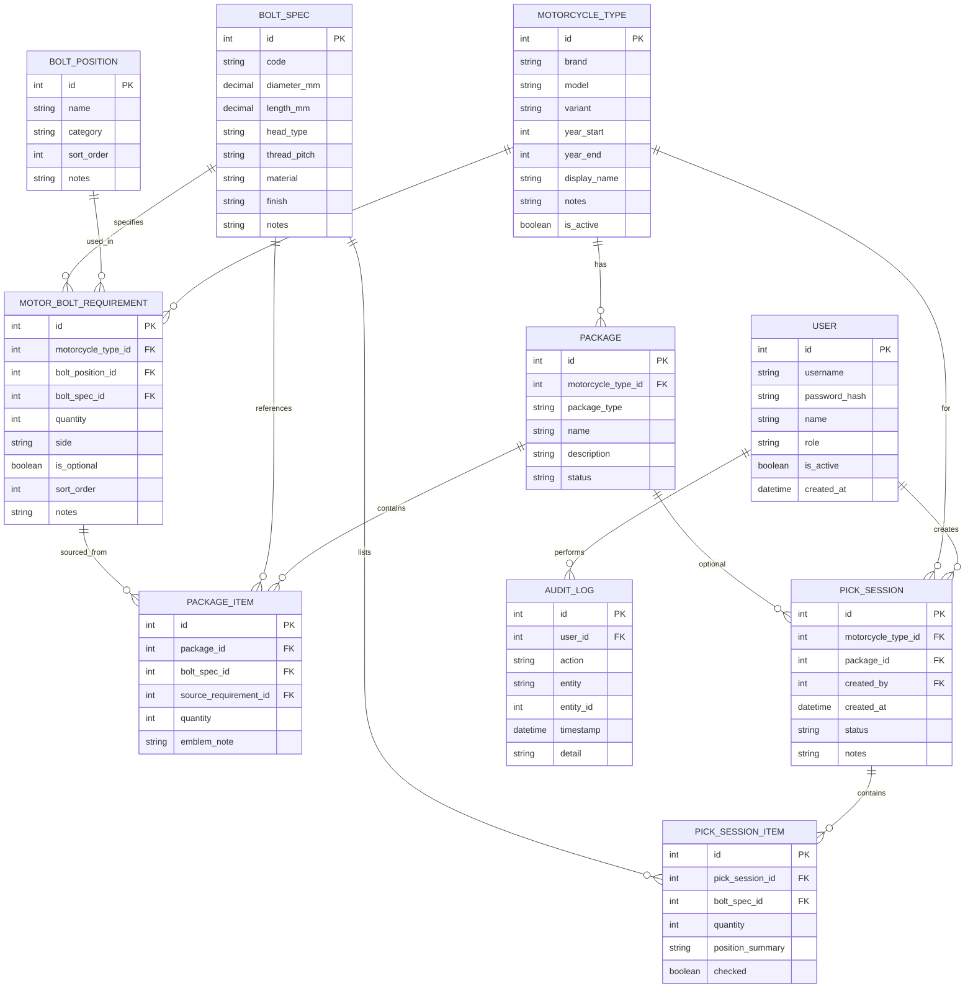

---

## 6. Functional Flow Diagrams

### F1. Login and Role Authorization

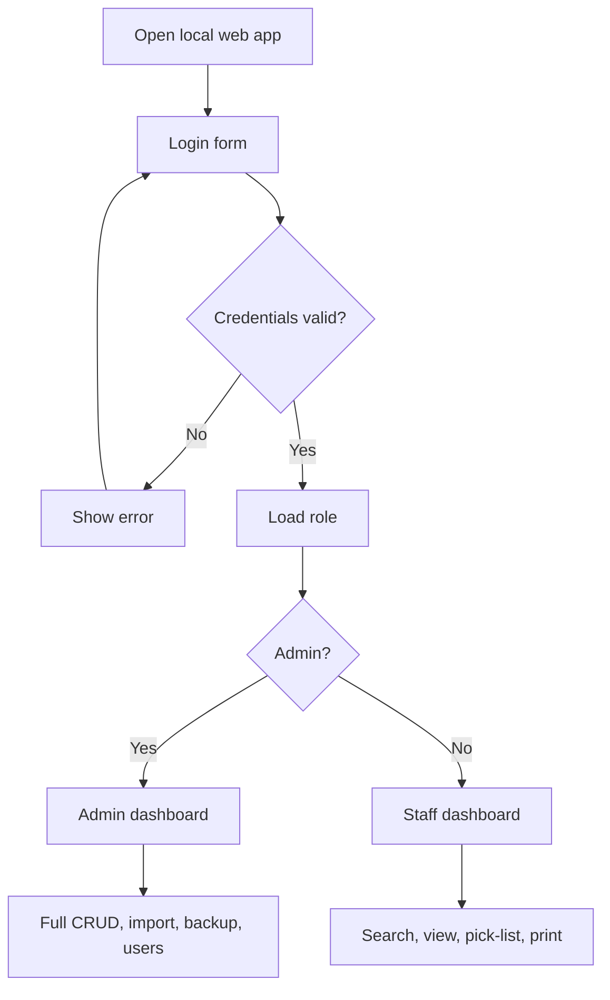

### F2. Motorcycle Master CRUD

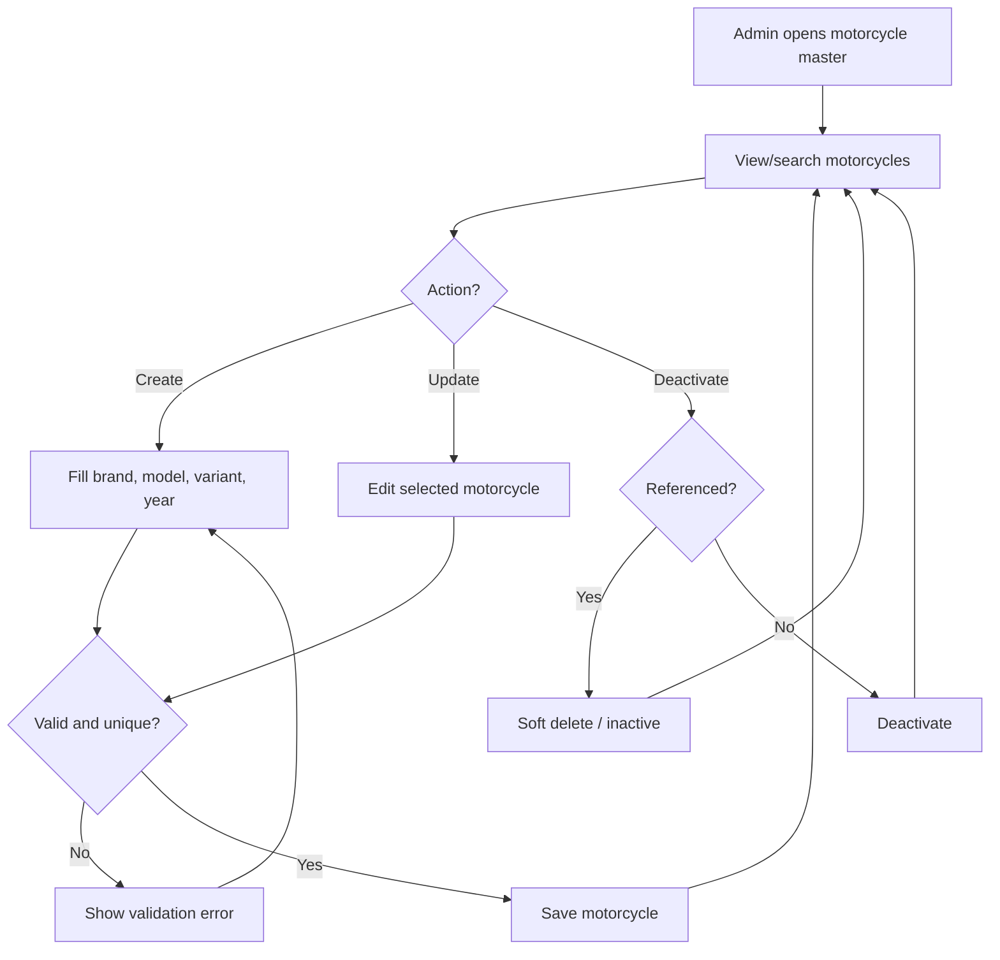

### F3. Bolt Position and Bolt Specification Master

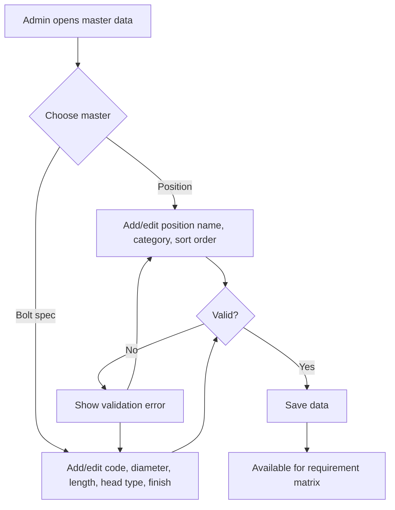

### F4. Motorcycle Bolt Requirement Matrix

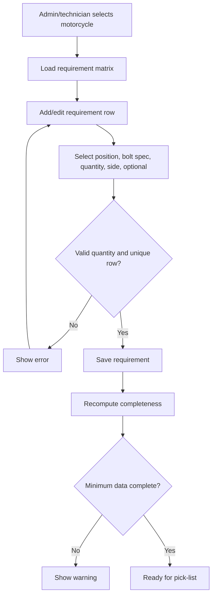

### F5. Automatic Pick-List by Motorcycle

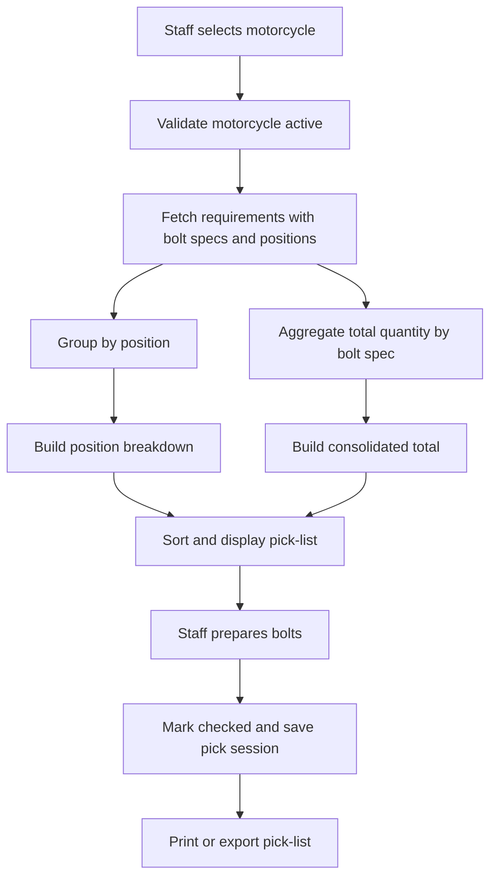

### F6. Automatic Pick-List by Package

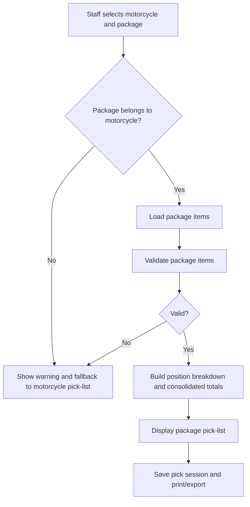

### F7. Pick Session Checklist and Print/Export

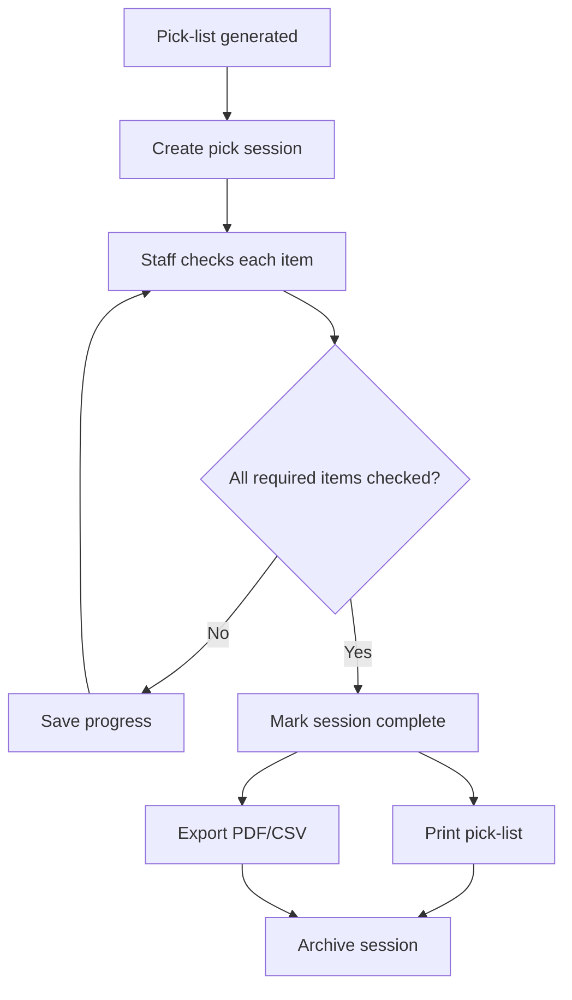

### F8. CSV Import for Requirements

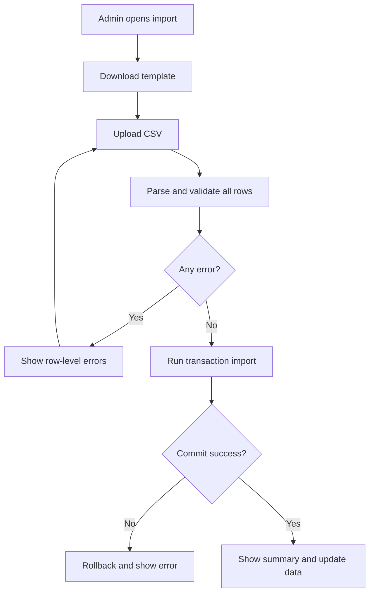

### F9. Backup and Restore

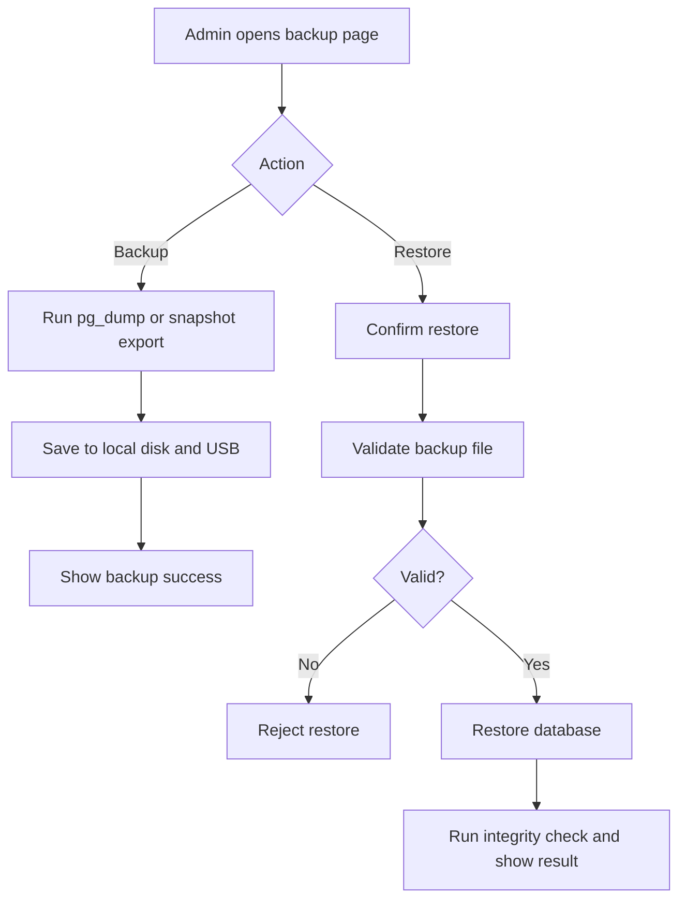

### F10. Program 1 End-to-End Delivery Process

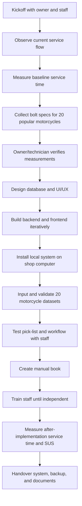

---

## 7. API Outline

Suggested REST endpoints:

```text
POST   /api/auth/login
GET    /api/auth/me

GET    /api/motorcycles
POST   /api/motorcycles
GET    /api/motorcycles/:id
PUT    /api/motorcycles/:id
PATCH  /api/motorcycles/:id/deactivate

GET    /api/positions
POST   /api/positions
PUT    /api/positions/:id

GET    /api/bolt-specs
POST   /api/bolt-specs
PUT    /api/bolt-specs/:id

GET    /api/motorcycles/:id/requirements
POST   /api/motorcycles/:id/requirements
PUT    /api/requirements/:id
DELETE /api/requirements/:id

GET    /api/packages?motorcycle_id=:id
GET    /api/packages/:id/items

POST   /api/pick-lists
GET    /api/pick-lists/:id
PATCH  /api/pick-lists/:id/items/:itemId

POST   /api/import/requirements
GET    /api/admin/backup
POST   /api/admin/restore
GET    /api/audit-logs
```

---

## 8. Deployment and Operation Notes

- Install PostgreSQL, Node.js runtime, and the app on the shop computer.
- Bind backend to `0.0.0.0` only on LAN, use firewall rules.
- Staff phones access via `http://<shop-pc-local-ip>:<port>`.
- Use a static local IP or DHCP reservation for the shop computer.
- Schedule daily `pg_dump` backup to local disk and USB.
- Test restore procedure before handover.
- Keep Kelola for cashier/transactions; this system only supports bolt preparation.
- Provide printed and in-app SOP:
  - how to search motorcycle,
  - how to generate pick-list,
  - how to mark checklist,
  - how to print/export,
  - how to backup/restore,
  - what to do when data is missing.

---

## 9. Evaluation and Acceptance Criteria

Program 1 is accepted if:

1. System runs locally on the shop computer.
2. System is accessible from at least one staff smartphone on shop Wi-Fi.
3. Database contains at least 20 motorcycle types.
4. Pick-list can be generated by motorcycle and by package.
5. Pick-list shows position breakdown and consolidated totals.
6. Staff can mark checklist and print/export.
7. Manual book is available.
8. At least 2 staff can operate the system without owner assistance.
9. Bolt preparation time per motorcycle is reduced by at least 50% vs baseline.
10. SUS evaluation is collected and reported.
11. Backup and restore are demonstrated.
12. Partner accepts handover via berita acara.

---

## 10. Key Notes and Open Questions

- **Data accuracy is the highest risk.** Bolt measurements must be verified by owner/technician before being marked “published.”
- Recommend a `draft / verified` status for requirement data.
- If a motorcycle has incomplete requirements, pick-list should show a warning instead of silently producing incomplete results.
- Package composition should be read-only in Program 1; discount and final pricing stay in Program 3.
- If the shop has multiple computers, define which one is the server/localhost host.
- Decide whether staff can edit requirements or only Admin/technician.
- Decide whether pick-list export is PDF, CSV, print-only, or WhatsApp share via local print/screenshot.
- Recommend audit log from day one for accountability.
- Recommend a simple in-app “data completeness dashboard” showing which of the 20 motorcycles are incomplete.
- Do not expose the app to the public internet.
